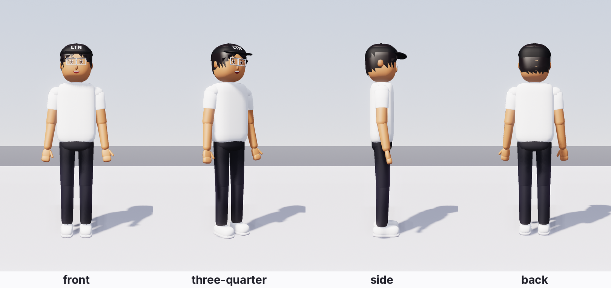

# Reusable assets — where everything lives

| What | Where | Notes |
|---|---|---|
| **Main character (3D, current)** | [`characters/yub-3d/`](characters/yub-3d/README.md) | white tee, black jeans, middle part, silver glasses, black LTN cap; 11 expressions, poses, OBJ export, preview sheets |
| Main character (2D pixel sprite, older) | [`characters/main-guy/`](characters/main-guy/README.md) | pixel explainers |
| Stick figures | [`characters/stickman/`](characters/stickman/README.md) | stick-fight explainers |
| **3D renderer + video engine** | [`lib/cine3d/`](lib/cine3d/README.md) | soft-lit low-poly renderer, captions/hook/mix engine, SFX, splice tool |
| **Car models + logos** | [`lib/cine3d/cars3d.py`](lib/cine3d/cars3d.py) | Ioniq 5 N, Chevrolet Blazer EV, Jeep Wrangler JL, Willys MB, Tesla Model 3; preview `lib/cine3d/previews/cars.png` |
| Props / effects | [`lib/cine3d/props3d.py`](lib/cine3d/props3d.py) | light beams, floodlights, gears, speakers, neon signs, energy flow, graphs, parachute, snail, duck |
| Latest finished videos (source) | [`videos/yub-cine/`](videos/yub-cine/README.md) | ioniq_fake_gears, gm_carplay, jeep_wave + SUMMARY.md (facts, sources) |
| Visual rules (pixel style) | [`styles/explainer-style.md`](styles/explainer-style.md) | |

