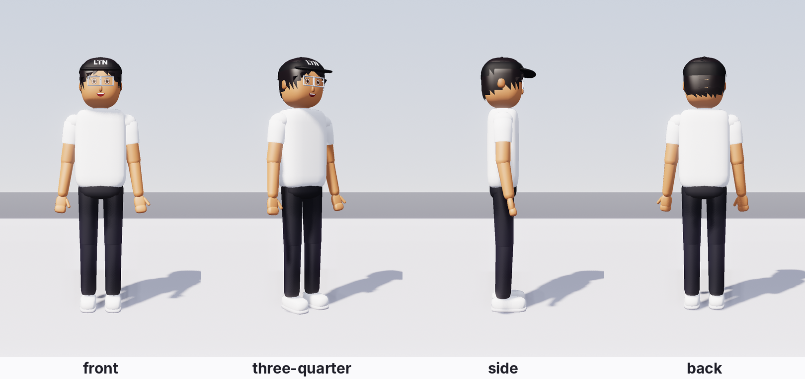
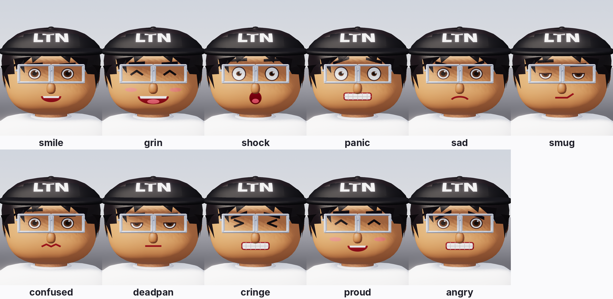
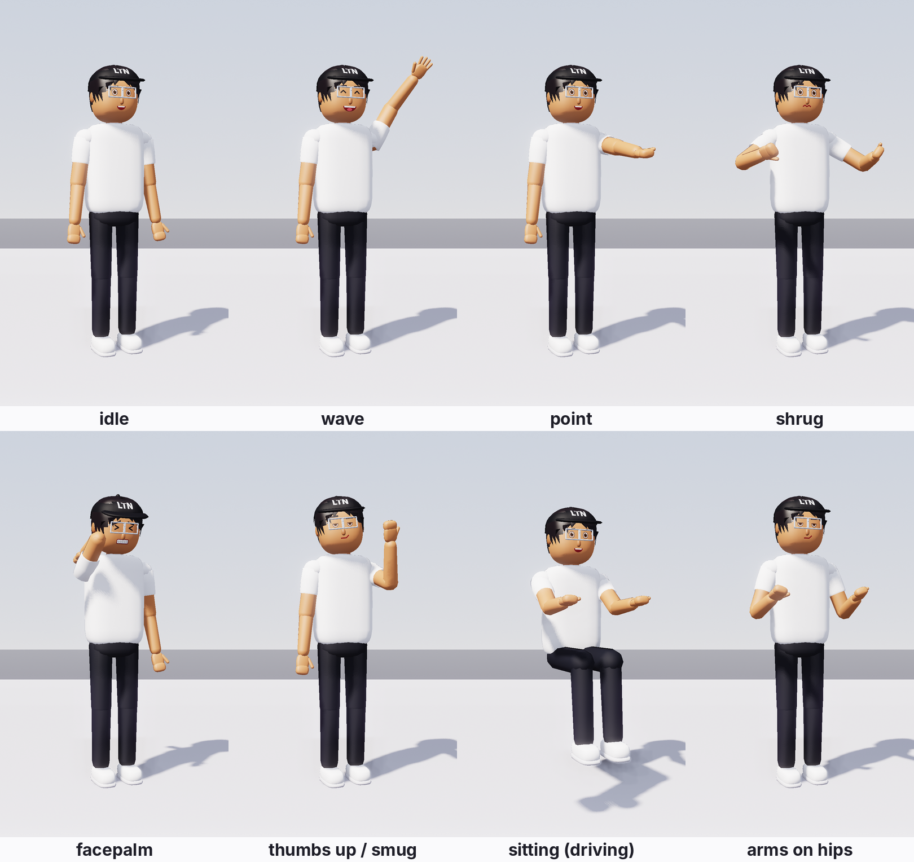

# Yub — the channel's main character (3D)

The main character of the Yub Cars channel (@yub_cars), built for the cinematic low-poly look. Use this folder for every new 3D video.



## Look (keep this recognisable)
| Part | Spec |
|---|---|
| Skin | brown `#be805a` (shade `#a06848`) |
| Hair | dark `#1e181c`, **middle part** — curtain fringe falling to both sides |
| Glasses | silver square frames (3D, chrome) |
| Cap | black baseball cap, white **LTN** logo on the front |
| Top | plain **white T-shirt** (short sleeves, crew neck) |
| Bottoms | **black jeans** |
| Shoes | white sneakers |
| Proportions | big friendly head so expressions read on a phone |

## Files
| File | What it is |
|---|---|
| `yub.py` | the character: `yub(expr, look, la, ra, head, sit, step, lean, held, wave, sweat, blush, bob, hat)` |
| `facedraw.py` | the 2D face texture (eyes, brows, mouth) for every expression |
| `make_previews.py` | re-renders the sheets in `previews/` |
| `export_obj.py` | exports `export/yub.obj` + `.mtl` + face/logo PNGs for Blender or any 3D app |
| `previews/` | `turnaround.png`, `expressions.png`, `poses.png` |
| `export/` | `yub.obj` (neutral smile pose, metres, Y up, facing +Z, feet at y = 0) |

## Use it
```python
import sys; sys.path.insert(0, "characters/yub-3d")     # also puts lib/cine3d on the path
from yub import yub, EXPR_NAMES
from geo import Cam, tiles
from render3d import render, Env

me = yub("grin", ra=(0, 150, 30), wave="r")               # waving, grinning
img = render([tiles(-4, -4, 4, 4, 0, 2), me], Cam((0, 1.2, 3.4), (0, 1.0, 0), 45), Env())
```
- **Expressions** (`expr`): `smile grin shock panic sad smug confused deadpan cringe proud angry` — see `previews/expressions.png`.
- **Eyes** (`look`): `c` centre, `l`, `r`, `u` up. Extras: `sweat=True`, `blush=True`.
- **Arms** (`la`, `ra`) = (raise forward °, out to the side °, elbow bend °). `wave="l"/"r"` opens that hand. `held=<mesh>` puts a prop in the right hand.
- **Head** = (yaw, pitch, roll) °. `lean` tilts the upper body. `step` swings the legs. `sit=True` seats him (seat height 0.5 m) — in a car use `.rot("y", 90).mv(seat_x, seat_y - 0.5, seat_z)`.
- `hat=False` removes the LTN cap.




Common poses (from `previews/poses.png`): idle `yub()`, wave `ra=(0,150,30), wave="r"`, point `ra=(80,10,0)`, shrug `la=ra=(25,55,80)`,
facepalm `la=(135,10,150), expr="cringe"`, smug thumbs-up `ra=(75,10,85), expr="smug"`, driving `sit=True, la=ra=(55,4,40)`, hands on hips `la=ra=(10,20,100)`.

The older flat/pixel versions of the character are in `characters/main-guy/` (2D sprite) and the skit videos.
