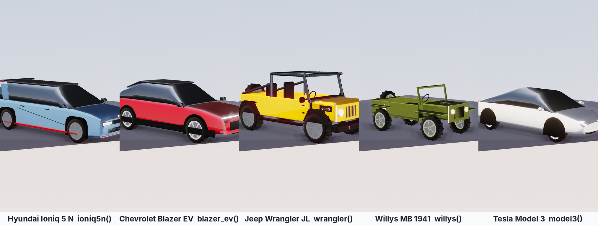

# cine3d — reusable cinematic low-poly toolkit

Everything a new 3D car short needs, shared by `videos/yub-cine` and future videos. Pure Python (numpy + Pillow + ffmpeg).
The look matches the "how matrix headlights work" reference: soft-lit smooth low-poly, sun shadows, ambient occlusion, glossy paint,
bloom, light beams, glow sprites, depth of field, saturated colour.

| File | What it gives you |
|---|---|
| `geo.py` | geometry: `P` triangle bags (`mv rot sc smooth glow mat keep`), `bbox`/`cb` bevelled boxes, `superellipsoid`, `sphere`, `capsule`, `lathe`, `loft` (car bodies), `cyl`, `tiles`, `panel`, `word_tex` (text textures), `Cam`, materials `MATTE PAINT GLASS CHROME SATIN SKIN GLOW RUBBER SCREEN CLOTH HAIR` |
| `render3d.py` | the renderer: `render(scene, cam, Env(...), glow=[], sprites=[], shadow_center=None)` → 810×1440 RGB. `Env` = sky, sun, fog, exposure, bloom, point/spot lights |
| `engine3d.py` | the video runner: hook title from frame 0, one-word captions (fixed, centred, never clipped — `check` verifies every frame), contact sheets, meta, voice + music + rock backbeat + SFX mix, multi-core MP4 export |
| `cars3d.py` | real cars: `ioniq5n()`, `blazer_ev()` (Chevrolet/GM), `wrangler()` (Jeep JL), `willys()` (1941 MB), `model3()` (Tesla); wheels, arches, drawn logos (Hyundai H, N, Chevy bowtie, GM, Jeep, Tesla T) |
| `props3d.py` | `beam` (volumetric light cone), `floodlight`, `gear`, `speaker`, `rings` (sound waves), `neon_sign`, `flow` (glowing energy tube), `line_graph`, `grid_panel`, `screen_tex`, `snail`, `duck`, `chute`, `speed_lines` |
| `sfx.py` | synthesised SFX: pop whoosh sparkle ding thump boom stamp confetti vroom screech poof buzzer crash coin rimshot crickets boing honk grind sputter click kick snare cymbal |
| `splice.py` | re-render only some time ranges of a finished MP4 and splice them in (audio untouched) |
| `make_car_previews.py` | re-renders `previews/cars.png` |

## New video in 4 steps
1. Copy `videos/yub-cine/src/{_lib.py,script.py,tts.py,align.py,retime.py}` and one shot file (e.g. `jeep.py`) into `videos/<new>/src/`.
2. Write the narration in `script.py`, then run TTS once, align, retime (commands in `videos/yub-cine/README.md`).
3. Write the shots: each `fn(u, t, dt)` returns `dict(scene=[...], cam=Cam(...), env=..., glow=[...], sprites=[...])`. Use `from yub import yub` for the main character.
4. `python <name>.py sheet out.png` → check → `python <name>.py video voice.wav music.wav out.mp4`.

Music bed used so far: Kevin MacLeod "Hot Swing" (incompetech.com, CC BY 4.0, credit required) — download the mp3 and convert to 48 kHz stereo WAV.
